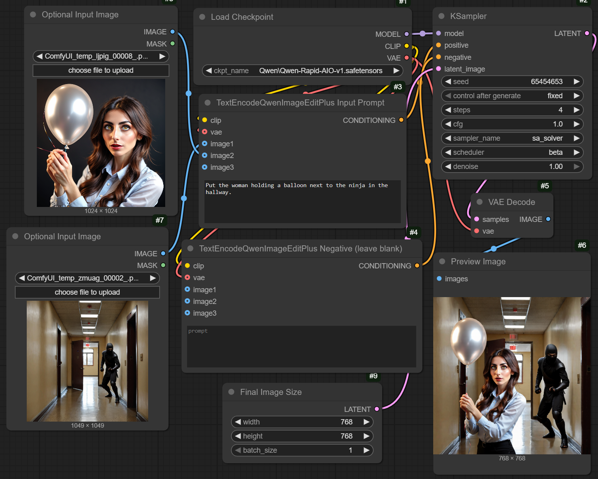

# Model workflows

A model in AI Image Edit is a *model workflow*: one JSON file that holds a
[ComfyUI](https://github.com/Comfy-Org/ComfyUI) workflow and a manifest
describing everything the app needs to run it (weights to download, custom
nodes to install, variants, which workflow inputs the prompt, seed and images go
to). The app starts a ComfyUI process, loads the workflow into it and downloads
what is missing when the model starts. Adding or changing a model needs no
Python; see [workflow files](contributing/workflow_files.md) for the format and
[adding a model](contributing/extending.md).

## Choosing a workflow

| Setting | Meaning |
|---|---|
| `--workflow NAME_OR_FILE` / `MODEL_WORKFLOW` | The bundled workflow to run (default `qwen_image21`), or the path of a workflow file of your own. `--list-workflows` prints the bundled names. |
| `--variant ID` / `MODEL_VARIANT` | One of the workflow's variants, e.g. another quantization. |
| `--no-lora-downloads` / `DOWNLOAD_LORAS=0` | Skips downloading the LoRAs the workflow brings along. LoRAs already in the folder are still offered. On by default. |
| `--version` | Prints the app's version and exits. |

The deployment guides ([Docker](../deployments/docker/DEPLOY.md),
[RunPod](../deployments/runpod/DEPLOY.md),
[Hugging Face](../deployments/huggingface/DEPLOY.md)) list all other settings,
such as the ComfyUI arguments for each GPU size and the download options.

## Bundled workflows

### `qwen_image21` (default)

Qwen-Image-2.1 with the
[official ComfyUI weights](https://huggingface.co/Comfy-Org/Qwen-Image-2.1):
the bf16 diffusion model, text encoder and VAE.

- **Use it for:** the best quality, on GPUs with plenty of memory. It was tested
  on an A100; the 48 GB class is the practical minimum for bf16.
- **Variants:** `int8`, which uses less memory.
- **Steps:** 8 to 60, 40 by default. The official pipeline uses 40 to 50 steps
  with the euler sampler; ComfyUI's own template defaults to 25.
- **LoRA:** the official Turbo LoRA (listed as `8-Step Turbo`, from the same repository) is
  downloaded with the model and can be applied from the LoRAs section
  (strength 1 by default). It makes the model work like `qwen_image21_turbo`:
  set the steps to 8 and keep CFG at 1.
- **License:** the weights are under the
  [Qwen RESEARCH LICENSE AGREEMENT](https://huggingface.co/Qwen/Qwen-Image-2.1/raw/main/LICENSE):
  **non-commercial use only.** Using them means accepting it.

### `qwen_image21_turbo`

The official 8-step distilled version of Qwen-Image-2.1, from the same
[ComfyUI repository](https://huggingface.co/Comfy-Org/Qwen-Image-2.1) as
`qwen_image21`: bf16 diffusion model, shared text encoder and VAE.

- **Use it for:** much faster generation, with somewhat lower quality on small
  dense text and complex edits. Memory needs are those of `qwen_image21`.
- **Variants:** `int8`, which uses less memory.
- **Steps:** 1 to 16, 8 by default, with CFG 1 (the default); the distillation
  needs no guidance, so a higher CFG only makes it slower.
- **License:** the same Qwen RESEARCH LICENSE AGREEMENT: **non-commercial use only.**

### `qwen_image21_gguf`

Qwen-Image-2.1 as quantized
[GGUF weights](https://huggingface.co/abenzerps/Qwen-Image-2.1-Uncensored-GGUF),
loaded with the [ComfyUI-GGUF](https://github.com/pulb/ComfyUI-GGUF) custom node
(installed automatically at a pinned commit).

- **Use it for:** GPUs with little memory. A 16 GB GPU is enough (tested); the
  download is about 15 GB. Quality is somewhat below the bf16 weights.
- **Variants:** the quantization, from `Q4_0` over `Q4_K_M` (default), `Q5_K_M`
  and `Q6_K` to `Q8_0` and `BF16`. Larger is better and needs more memory. These
  are the third-party *uncensored* version of the model; the `standard-Q4_0` to
  `standard-Q8_0` variants are the unmodified model.
- **Steps:** 8 to 60, 40 by default.
- **License:** the GGUF files are third-party conversions of the Qwen-Image-2.1
  weights and are under the same
  [Qwen RESEARCH LICENSE AGREEMENT](https://huggingface.co/Qwen/Qwen-Image-2.1/raw/main/LICENSE):
  **non-commercial use only.**

### `qwen_image21_turbo_gguf`

The Turbo model as quantized
[GGUF weights](https://huggingface.co/unsloth/Qwen-Image-2.1-Turbo-GGUF) by
Unsloth, loaded with the same ComfyUI-GGUF custom node as `qwen_image21_gguf`.

- **Use it for:** fast generation on GPUs with little memory.
- **Variants:** the quantization, from `Q2_K` over `Q4_K_M` (default) and `Q8_0`
  to `F16`. Larger is better and needs more memory; below `Q4_K_M` quality drops
  noticeably at 8 steps.
- **Steps:** 1 to 16, 8 by default, with CFG 1.
- **License:** the same Qwen RESEARCH LICENSE AGREEMENT: **non-commercial use only.**

### `qwen_image_edit_2511_aio`

Qwen-Image-Edit 2511 in
[Phr00t's Rapid-AIO merge](https://huggingface.co/Phr00t/Qwen-Image-Edit-Rapid-AIO),
combined with a curated set of LoRAs (camera angle changes, style transfer,
photo-realism, polaroid look, unblurring and upscaling, comic and noir styles,
Pixar-style 3D, pose transfer). The LoRAs are downloaded with the model and can
be applied from the UI.

- **Use it for:** fast edits: it needs only 1 to 10 steps (4 by default) and
  supports a LoRA strength setting.
- **License:** the weights and LoRAs come from third parties; check the licenses
  of the linked repositories before use.

The workflow is based on the ComfyUI workflow from
[Phr00t's Hugging Face page](https://huggingface.co/Phr00t/Qwen-Image-Edit-Rapid-AIO):

## Postprocessing

The **Postprocessing** box in the page's Advanced settings controls what happens
to a result after the model has produced it. It applies to every workflow.

| Setting | Applies to | Meaning |
|---|---|---|
| Masked edits | Edits with a mask | **Rescale edited area to original size** (default): the result keeps your original's size and every pixel outside the edited area; only the edited area is taken from the generated image, scaled to fit. **Rescale original to generated size**: your original is scaled to the size the model generated at, and the result has that size. |
| Match sharpness and grain | Edits with a mask, in the default mode | On by default. When the edited area had to be enlarged, it looks softer and smoother than the rest of the photo; this sharpens it a little and adds fine grain to match the photo's own. The more it was enlarged, the stronger the effect. Off keeps the area exactly as the model made it. |
| Apply color corrections | Edits without a mask | Off by default. If the model shifts the colors of the whole picture, so the result looks duller, darker or tinted next to your photo, this evens the shift out, while what you asked to change keeps its new colors. Small shifts that don't show are left alone, a color change you asked for across the whole picture may be toned down, and when nearly all colors changed, nothing is corrected. It only works when the result keeps your photo's aspect ratio. |

With a mask, the edited area's colors are always matched to your photo,
whatever the color correction switch says. These settings act after inference,
so changing them does not run the model again for a request it has already
generated.

## Downloads and custom nodes

When a model starts, the app lists the weight files, LoRAs and custom nodes its
workflow needs and fetches only what is missing, with parallel ranged downloads,
resume support and a checksum check. Until the last file is there and ComfyUI
has started, the Generate button stays off and the page shows the progress
(a failed download or a ComfyUI that stops while starting is reported there
too). Mount a
volume at the models folder (see the Docker guide) so the weights are downloaded
only once.

Custom nodes are installed from git at an exact, pinned commit, so a workflow
keeps working when the node's repository changes. Their requirements are
installed with pip.

## Versions

The version shown in the UI is the manifest's `model_version`, or the variant's
if it has one.
